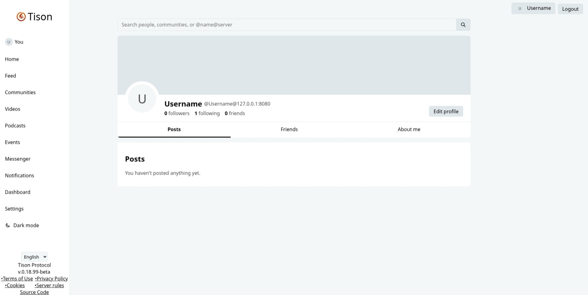
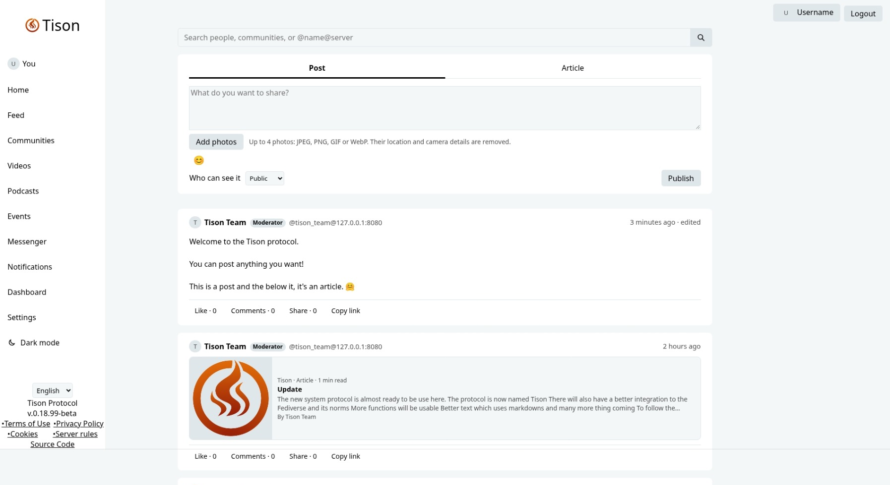
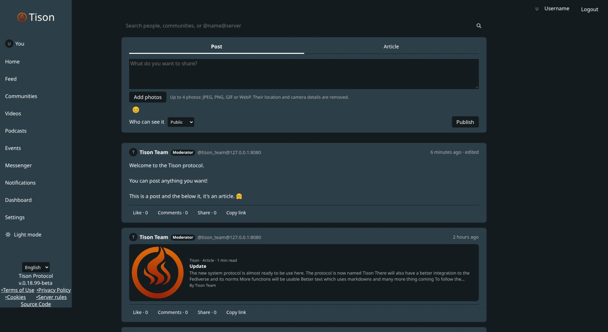
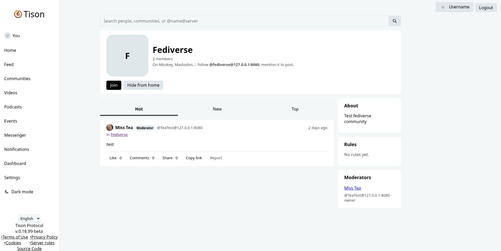
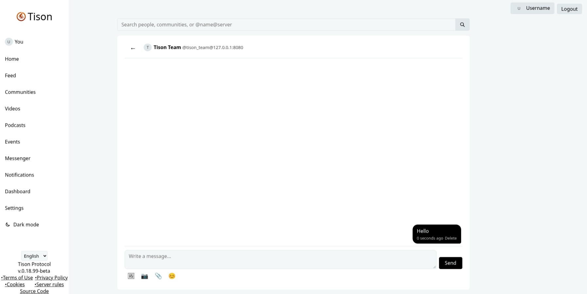
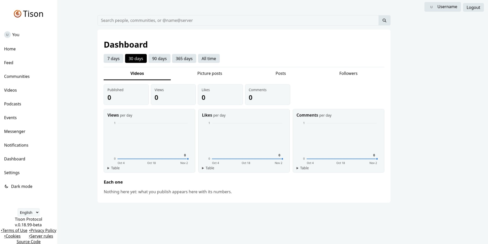
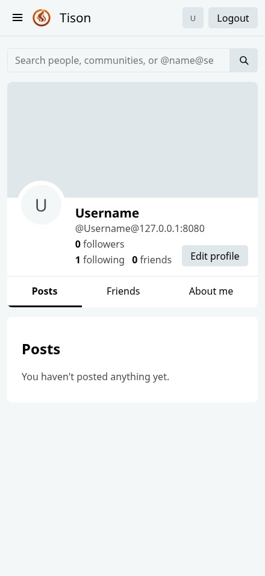
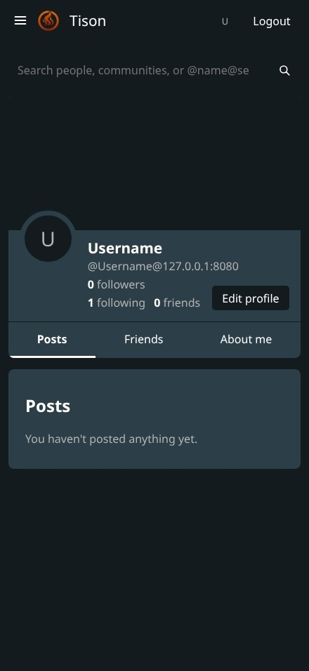

# Tison
Multi-typed Fediverse protocol written in Rust, created to make any kind of services or combine them for only one account usage.

It gives the admin to choose the types of services they wants to mainly focus on:
 - Macro Blogging
 - Image sharing
 - Video
 - Audio streaming
 - Content Aggregator
 - Publishing (Blogging)
 - Event planning
 - Distributed Friends & Relations Network

It also add native bridges to other protocols like:
 - AT Protocol
 - diaspora
 - Matrix
 - ZOT

## Why ???
 For multiple reasons:
  - Cost-effective since it is written in Rust
  - The ability to have all the accounts associated with one user instead of fragmenting all the followers into multiple services
  - The ability to share easily with multiple content types
  - Let the admins to let their users to cross-share with classic network to attract new users into the Fediverse
  - Add the ability to live stream into the Fediverse
  - And by passion !

### Used on my own instance
https://instavox.social/

## Roadmap to the v1

 - (Completed) v0.1 > the first fully operational function (Content-Aggregator)
 - (Completed) v0.2 > DFRN
 - (Completed) v0.3 > Moderator system
 - (Completed) v0.4 > Content Type system
 - (Completed) v0.5 > Image
 - (Completed) v0.6 > Publishing
 - (Completed) v0.7 > Audio podcast
 - (Completed) v0.8 > Video
 - (Completed) v0.9 > Live Streaming
 - (Completed) v0.10 > Video compression system
 - (Completed) v0.11 > Event planning
 - (Completed) v0.12 > 2FA system
 - (Completed) v0.13 > Add Web browser systems, like notifications
 - (Completed) v0.14 > Enhancing the systems, like the publishing and notifications
 - (Completed) v0.15 > Add views and statistics
 - (Completed) v0.16 > Add a dashboard for creators
 - (Completed) v0.17 > Add translation system
 - (Completed) v0.18 > Add the necessary pages for legal use and Fediverse norms
 - (Completed) v0.19 > Fix texts and menus
 - (Completed) v0.20 > Badges system
 - (Completed) v.21 > Add a relay system for post and users
 - (Current) v0.22 > Apply corrective to the federation system and enhancing even more functions
 - v0.23 > API to connect from other server and to connect to other servers
 - v0.24 > AT Protocol Bridge integration
 - v0.25 > Diaspora Bridge integration
 - v0.26 > ZOT Bridge integration
 - v0.27 > Matrix Bridge integration
 - v0.28 > Cross-posting
 - v0.29 > Cleaning up the code and comments
 - v0.30 > Add more badges
 - v0.31 > Preparation for the full release
 
 - v1.0 > Fully functional system and cleaned up that shows contents and users from other instances with multi-user links and notifier that notifies the publication of new content by users.

 Possible new features to be added
 - Algorithm option for admin server and for user when active on server
 - Wikipedia preview system to show information recognized in posts

## Screenshots (changes can occur)
       

 ## Legal pages
 Modify the files in legal to your local laws.
 The model given is not final and/nor usable and is for an example only and mostly based on laws of the province of Québec, Canada.
